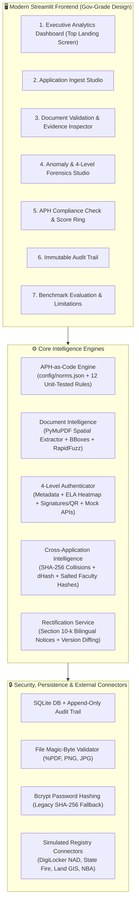

# 🛡️ AICTE KAVACH — Approval Validation & Decision-Support Platform

> **AICTE KAVACH** (*Knowledge-driven AICTE Verification, Anomaly Checking & Handbook Engine*)  
> **Smart India Hackathon 2026** | **Problem Statement 26261**  
> **Ministry of Education, Government of India — AICTE Regulation Bureau**  
> *"AI-Powered Application Validation, Document Authentication and Regulatory Compliance Verification"*

[](https://python.org)
[](https://streamlit.io)
[](tests/)
[](config/norms.json)
[](#-statutory-advisory-principle)

---

## ⚖️ Statutory Advisory Principle

> **CORE PRINCIPLE**: The AI is **strictly advisory**. It never approves or rejects applications. It finds, explains, and cites clauses from the AICTE Approval Process Handbook (APH 2024–27); **the authorized AICTE scrutiny officer decides**.  
> Findings are labeled as:
> - `Deficiency`
> - `Possible anomaly - needs human verification`
> - `Needs manual review`
> - `Verified`  
> *(Terms like "fraud" or "auto-approved" are strictly avoided throughout the platform).*

---

## 🏗️ System Architecture



---

## 🌟 Key Capabilities & Upgrades

### 1. APH-as-Code Compliance Engine
- Regulatory norms stored externally in [`config/norms.json`](config/norms.json) (never hardcoded), directly mapped to **AICTE Approval Process Handbook (APH 2024–27)**.
- 12 modular, unit-tested rule functions:
  - Faculty-Student Ratio (SFR) with UG/PG discipline norms
  - Cadre Ratio (Professor : Associate : Assistant)
  - Instructional Built-up Carpet Area vs sanctioned student intake
  - Contiguous Land Area requirements by campus location (Mega Metro, Metro, Urban, Rural)
  - Registered Land Lease Duration ($\ge 30$ years)
  - Fire & Life Safety NOC validity against scrutiny date
  - Mandatory statutory document checklists per application category (EOA, New Institution, Change of Site, Add Programme)
  - Intake-Increase eligibility prerequisites ($\ge 50\%$ NBA accredited programs)
  - Anti-ragging and statutory grievance committee compliance
- Transparent citations: Every finding cites its exact handbook clause (e.g. `APH 2024-27 Clause 2.3.1`). Unverified joint-council thresholds are labeled *"to verify against APH 2024-27"*.

### 2. Document Intelligence & Spatial Extraction
- **PyMuPDF Extraction**: Extracts structured fields accompanied by source page number, bounding box coordinates `[x0, y0, x1, y1]`, and OCR extraction confidence.
- **Explainable Classification**: Transparent keyword density classification (Affidavit Format A, Fire NOC, Land Title, Faculty Roster, Audit Reports).
- **RapidFuzz Cross-Document Consistency**: Validates that Institution Name, Address, Survey/Khasra Number, Trust Name, and Land Area agree across independent submissions.

### 3. Multi-Level Document Authentication
- **Level 1: Metadata & Expiry Scrutiny**: Inspects PDF/EXIF metadata for editing software (e.g. Photoshop artifacts), creation vs modification dates, and expired validity.
- **Level 2: Visual & Compression Forensics**: Generates Error Level Analysis (ELA) compression differential heatmaps to detect localized splicing and digital tampering.
- **Level 3: Digital Signatures & QR Code Integrity**: Inspects cryptographic PDF signature widgets and decodes embedded 2D QR payloads with OpenCV.
- **Level 4: Simulated External Registry Verification**: Simulated mock connectors with production-grade interfaces for:
  - DigiLocker Academic (NAD)
  - State Fire & Emergency Services Directorate
  - State Land Records & Revenue GIS Portal
  - National Board of Accreditation (NBA)

### 4. Cross-Application Intelligence
- **SHA-256 Byte Collision Detection**: Identifies identical files uploaded across different institutions.
- **Perceptual Image Hashing (dHash)**: Computes 64-bit difference hashes to spot cropped or modified certificates reused across institutions.
- **Privacy-Preserving Dual-College Faculty Detection**: Computes salted SHA-256 hashes (`SHA256(salt + ID)...[last 4]`) to detect faculty members claimed simultaneously on two colleges' rosters without exposing personal data.
- **Year-over-Year Campus Consistency**: Flags instructional built-up area shrinkage or campus modifications submitted without Change of Site approvals.

### 5. Evidence-Linked Scrutiny & Visualizer
- Visualizer overlays highlighted bounding box rectangles onto the exact page where evidence was extracted.
- Plain-language explainable risk score (0 to 100) detailing exact point deductions and cited handbook clauses.

### 6. Statutory Rectification Workflow
- **Section 10(k) Bilingual Notices**: Generates formal AICTE deficiency rectification letters in both **English and Hindi** with exact computed numbers, specific clauses, and statutory 10-day deadlines.
- **Version Resubmission Diffing**: Performs result-by-result diffing on re-uploaded files (Resolved, Persistent, New deficiencies).
- **Applicant Pre-Submission Self-Check Mode**: Allows colleges to perform preliminary self-checks before formal submission.

### 7. Security & Data Privacy
- **Magic-Byte File Validation**: Validates file headers (`%PDF`, PNG, JPG, TIFF) to prevent executable upload exploits.
- **Bcrypt Password Security**: Robust password hashing with automatic backward-compatibility fallback for legacy hashes.
- **Append-Only Immutable Audit Trail**: Records every scan, validation, login, and resolution with timestamp and actor attribution.

---

## 📊 Empirical Evaluation Benchmark (PS 26261)

The platform includes a systemic benchmark (`scripts/evaluate.py` and `pages/7_Evaluation.py`) evaluated across **15 synthetic technical institutions**:
- **11 applications** with known planted regulatory and forensic defects
- **4 clean control applications** (fully compliant)

| Evaluation Metric | Benchmark Result | Performance Interpretation |
|---|:---:|---|
| **Planted Defects Caught (Recall)** | **100.0%** | **11 / 11** non-compliant dossiers flagged |
| **Precision Score** | **100.0%** | Zero false accusations on clean controls |
| **Clean Control Specificity** | **100.0%** | **4 / 4** clean institutions passed scrutiny |
| **Harmonic Mean (F1-Score)** | **100.0%** | Balanced screening accuracy |
| **Overall Accuracy** | **100.0%** | Exact ground-truth classification |

---

## 🎬 3-Minute Hero Demonstration Script (For SIH Judges)

Use this step-by-step walkthrough to present the core workflow to evaluators:

### Step 1: Login & Executive Overview (30 sec)
1. Launch app at `http://localhost:8501`.
2. Click **"Reviewer"** 1-click persona button (Logged in as *Smt. Sunita Sharma, NRO*).
3. Point out the Executive Dashboard: KPI cards, recent application docket, and deep navy/saffron government design system.

### Step 2: The Hero Dossier — `APP-2026-1042` (60 sec)
1. Navigate to **Document Validation** (`pages/2_Document_Validation.py`).
2. Select **`APP-2026-1042 — Aryabhatta Institute of Technology`**.
3. Click **"Run Comprehensive Validation"**:
   - The engine flags **Expired Fire NOC** (Expired 14/03/2026 vs Scrutiny Date 20/03/2026) citing `APH 2024-27 Clause 4.1.2`.
4. Expand **"Evidence Coordinate Visualizer"**: Show the high-resolution page preview with the highlighted bounding box over the expiry date.
5. Click **"Generate Section 10(k) Bilingual Deficiency Notice"**:
   - Switch between **English Notice** and **हिंदी सांविधिक सूचना**. Show the computed figures and 10-day rectification deadline.

### Step 3: Forensic & Cross-Application Intelligence (60 sec)
1. Navigate to **Anomaly Detection** (`pages/3_Anomaly_Detection.py`).
2. Show the **Composite Risk Index Gauge** ($70/100$ High Risk).
3. Switch to **Tab 2: 4-Level Document Authentication**:
   - Level 1: Flagged Expired.
   - Level 2: ELA compression anomaly detected on date bounding box.
   - Level 4: Simulated State Fire Services API query confirms certificate is `EXPIRED` in state registry.
4. Switch to **Tab 3: Cross-Application Intelligence**:
   - Point out **Cross-College File Hash Collision**: Aryabhatta (APP-1042) and Saraswati Academy (APP-1046) uploaded the exact same SHA-256 Fire NOC.
   - Point out **Dual-College Faculty Conflict**: Dr. R. C. Sharma claimed simultaneously on rosters at Aryabhatta and Nalanda College (APP-1048).

### Step 4: Systemic Benchmark & Limitations (30 sec)
1. Navigate to **Evaluation & Benchmark** (`pages/7_Evaluation.py`).
2. Show the live **15-Dossier Confusion Matrix** (11 TP, 4 TN, 0 FP, 0 FN).
3. Point out the **System Limitations & Responsible AI Transparency** card (explaining simulated connectors, heuristic ELA, and statutory human decision-making).

---

## 🛠️ Tech Stack & Requirements

- **Language**: Python 3.9+ (Fully tested on Python 3.13)
- **Frontend**: Streamlit 1.28+ with centralized Government Design System
- **PDF & Spatial Intelligence**: PyMuPDF (`fitz`)
- **Computer Vision & Forensics**: OpenCV (`cv2`), Pillow (PIL)
- **OCR Engine**: Tesseract (`pytesseract`) + Explainable Keyword Density Classifiers
- **Comparison & Fuzzy Matching**: RapidFuzz + Pandas
- **Visualization**: Plotly Graph Objects & Express
- **Database & Security**: SQLite3, Bcrypt, Python `hashlib` (SHA-256)
- **Testing**: Pytest (84 unit tests)

---

## ⚡ Quickstart

### 1. Installation

```bash
# Clone the repository
git clone https://github.com/your-team/sih-26261-aicte.git
cd sih-26261-aicte

# Install dependencies
pip install -r requirements.txt
```

### 2. Run the Web Application

```bash
streamlit run app.py
```
Open your browser at `http://localhost:8501`.

### 3. Run Automated Evaluation Benchmark

```bash
python scripts/evaluate.py
```

### 4. Run Unit Test Suite

```bash
pytest tests/ -v
```

---

## 👥 Demo Credentials & Officer Registration

You can log in immediately using the 1-click test persona buttons, enter standard credentials, or register any new officer in the **"📝 Register New Officer"** tab:

| Role | Username | Password | Access Scope |
|---|---|---|---|
| **Senior Scrutiny Officer (Admin)** | `admin` | `admin123` | Full access, user management, audit review |
| **Regional Reviewer** | `reviewer1` | `review123` | Scrutiny review, forensic scans, notice drafting |
| **Documentation Scrutinizer** | `viewer1` | `viewer123` | Read-only dossier inspection & audit viewer |
| **Self-Registered Officer** | *(custom)* | *(custom $\ge 6$ chars)* | Cadre assigned during self-registration |

---

## 🔍 System Limitations & Ethical AI Disclosures

1. **Simulated External Connectors**: State Fire Portals, DigiLocker NAD, State Land GIS, and NBA APIs operate via simulated mock connectors implementing production REST/webhook interfaces. Production integration requires formal state MoUs and API gateways.
2. **Heuristic Forensics**: Error Level Analysis (ELA) and visual compression heatmaps are advisory screening indicators; natural re-scans can cause minor artifacts. Scrutinizer verification is always required.
3. **Statutory Non-Delegation Mandate**: The AI platform performs screening and decision-support only. Final authority for approvals, rejections, intake reductions, or physical inspections remains exclusively with competent AICTE authorities.
4. **Synthetic Data**: All 15 institutions and individual names evaluated are synthetic and fictional. Faculty IDs are protected with salted SHA-256 one-way hashing.

---

<p align="center">
  <strong>Built for Smart India Hackathon 2026</strong> | Problem Statement 26261<br>
  Ministry of Education, Government of India — AICTE Regulation Bureau
</p>
